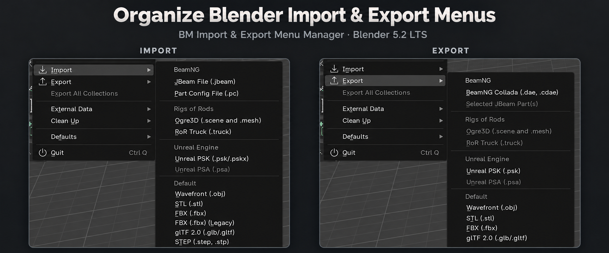
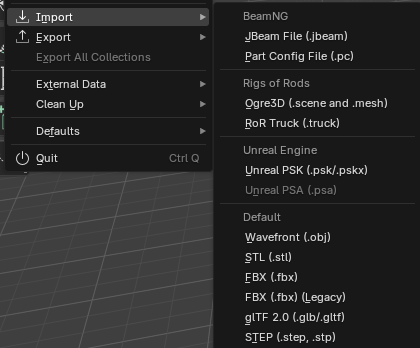
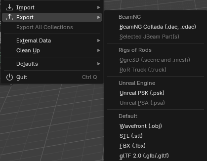

<p align="center">
  
</p>

<h1 align="center">BM Import & Export Menu Manager</h1>

<p align="center">
  A focused Blender add-on for organizing <strong>File → Import</strong> and
  <strong>File → Export</strong> without changing the underlying format add-ons.
</p>

<p align="center">
  
  
  
</p>

## Why use it?

Blender's Import and Export menus can become difficult to scan after several
format add-ons are enabled. BM Import & Export Menu Manager keeps those menus
readable while leaving every importer and exporter installed and available.

- Create labeled sections for related formats.
- Organize Import and Export independently.
- Hide entries you do not use without unregistering their operators.
- Rename menu entries while retaining their original behavior.
- Press and hold the dotted handle to drag entries or groups into position.
- Filter long preference lists by name, operator, or source add-on.
- Automatically discover formats registered by other add-ons.
- Restore Blender's original menus instantly with one master switch.

## Download

Download the current installer from the
[latest GitHub release](https://github.com/Mjamfan22/Blender-Import-Export-Menu-Manager/releases/latest).

Do not extract the ZIP before installing it in Blender.

## Requirements

- Blender 5.2 LTS or newer 5.2.x release
- Tested with Blender 5.2.3 LTS
- Windows, macOS, or Linux

## Installation

1. Download `BM_Import_Export_Menu_Manager_v1.1.2.zip` from **Releases**.
2. In Blender, open **Edit → Preferences → Extensions**.
3. Open the menu in the upper-right corner and choose **Install from Disk**.
4. Select the downloaded ZIP.
5. Enable **BM Import & Export Menu Manager** if Blender does not enable it
   automatically.
6. Expand the add-on's preferences and confirm that
   **Customize File Import and Export Menus** is checked.

## Quick start

1. Choose the **Import** or **Export** tab in the add-on preferences.
2. Click **Add** in the Groups section and enter a useful group name.
3. Use each entry's group menu to assign it to that section.
4. Press and hold the dotted handle, drag up or down, and release to reorder.
5. Open **File → Import** or **File → Export** to see the result.

> [!IMPORTANT]
> The master **Customize File Import and Export Menus** checkbox must be on.
> When it is off, Blender intentionally displays its original unmodified menus.

## What the result looks like

| Organized Import menu | Organized Export menu |
|:--:|:--:|
|  |  |

Groups are clean inline sections with optional separators and headings. They
are not nested fly-out submenus, so formats remain one click away.

## Preference controls

| Control | Purpose |
|---|---|
| Master checkbox | Apply the customized menus or immediately restore Blender's originals |
| Import / Export tabs | Configure the two menus independently |
| Search | Find an entry by display name, operator ID, or source add-on |
| Visibility checkbox | Show or hide one menu entry |
| Name field | Supply a custom readable label; leave blank for the original label |
| Operator ID | Identify the Blender operator behind the entry |
| Group menu | Assign an entry to a custom section or leave it ungrouped |
| Dotted handle | Press, hold, drag vertically, and release to reorder |
| Arrow buttons | Move one step at a time as an accessible fallback |
| Refresh | Discover formats added or removed during the current session |
| Reset | Restore the selected menu's default visibility, labels, grouping, and order |

### Group controls

- **Add** creates a group for the currently selected Import or Export tab.
- The **minus** toggle adds a separator before that group.
- The **text** toggle displays the group's name as a menu heading.
- The dotted handle and arrow buttons control group order.
- **X** removes the group and returns its entries to Ungrouped.

## Safety

This add-on changes menu presentation only. It does not unregister import or
export operators, edit Blender's installed scripts, or alter the files handled
by those operators. Hiding legacy FBX Import, for example, does not affect FBX
Export.

Disabling the manager or the add-on restores Blender's original callbacks,
including callbacks registered by other add-ons while the manager was active.

## Troubleshooting

### My groups do not appear

Make sure **Customize File Import and Export Menus** is checked, then close and
reopen the File menu. Also confirm that the entry is assigned to a group on the
correct Import or Export tab.

### A newly enabled format is missing

Click **Refresh**, or open the relevant File menu once so the manager can
discover the new callback.

### I cannot drag while searching

Clear the search box first. Reordering is disabled while filtered so hidden
entries cannot make the destination ambiguous.

### An entry is unavailable

Enable the add-on that provides that format and click **Refresh**. The manager
remembers unavailable entries so their settings return when the format becomes
available again.

## Building from source

```text
python tools/build_release.py
```

The command produces the installable extension ZIP in `dist/`. Development
files, caches, and repository documentation are excluded from the package.

## Contributing

Bug reports and focused improvements are welcome. Read
[CONTRIBUTING.md](CONTRIBUTING.md) before opening a pull request. For security
issues, follow [SECURITY.md](SECURITY.md).

## License

Released under the [MIT License](LICENSE).
